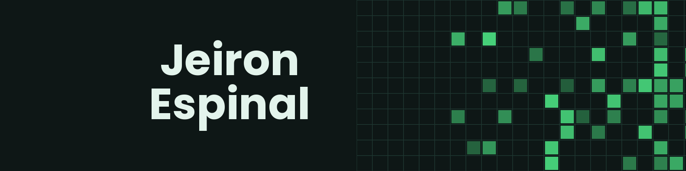
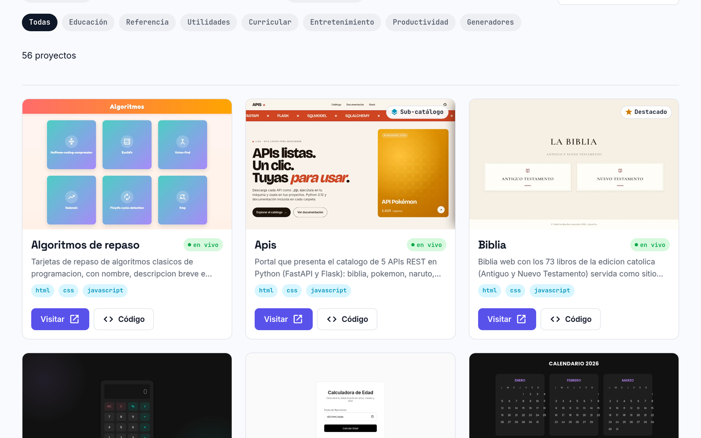
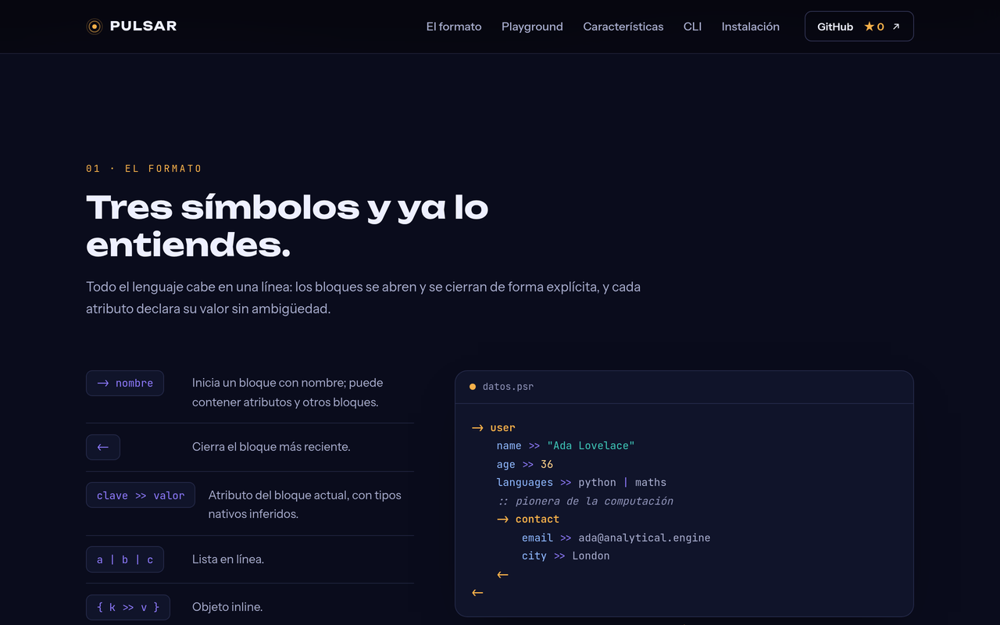
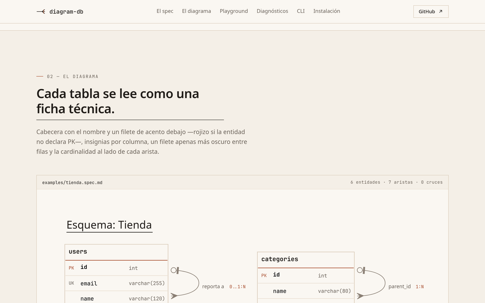
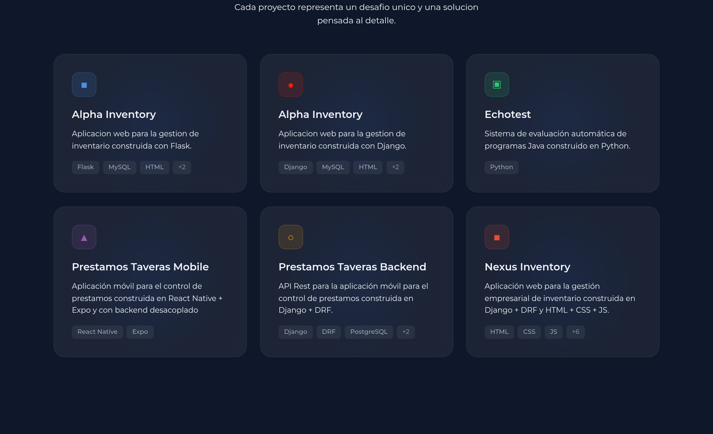

<div align="center">
  <a href="https://github.com/jeironpro">
    
  </a>
</div>

<br />

<div align="center">
  <p><strong>Backend developer en formación · Python · APIs REST · Bases de datos</strong></p>
  <p>Construyo software mantenible: código claro, APIs documentadas y proyectos que llegan a producción.</p>
  <!-- CIFRAS:INICIO -->
  <p><strong>10</strong> repositorios públicos &nbsp;·&nbsp; <strong>2</strong> paquetes en PyPI &nbsp;·&nbsp; <strong>56</strong> sitios desplegados</p>
  <!-- CIFRAS:FIN -->
  <p>
    <a href="#proyectos-destacados"></a>
    <a href="#stack-tecnológico"></a>
    <a href="#contacto"></a>
  </p>
</div>

---

## Sobre mí

Soy **Jeiron Espinal**, desarrollador enfocado en **backend**. Mi trabajo gira en torno a tres ideas: modelos de datos bien pensados, APIs que se entienden sin preguntar y un código que otra persona pueda retomar sin fricción.

- Desarrollo servicios y aplicaciones con **Python** (Flask, Django, FastAPI) y **Java**.
- Diseño **APIs REST** con autenticación por roles, validación, auditoría y documentación interactiva.
- Cuido el ciclo completo: base de datos, backend, frontend propio, contenedores y despliegue.
- Aprendo en público: publico mis proyectos en PyPI y en GitHub Pages, y documento cada repositorio.

Abierto a colaboraciones, prácticas y proyectos donde el backend tenga peso real.

---

## Stack tecnológico

<div align="center">

<p><sub><strong>BACKEND</strong></sub></p>


<p><sub><strong>BASES DE DATOS</strong></sub></p>


<p><sub><strong>FRONTEND</strong></sub></p>


<p><sub><strong>ENTORNO Y HERRAMIENTAS</strong></sub></p>


</div>

---

## Proyectos destacados

<table>
  <tr>
    <td width="50%">
      <a href="https://jeironpro.github.io/webs/"></a>
      <h3><a href="https://github.com/jeironpro/webs">webs</a></h3>
      <p>Monorepo de 56 sitios estáticos —ejercicios, cursos, herramientas y experimentos— con un catálogo que los indexa, filtra y despliega en GitHub Pages.</p>
      <p><code>React</code> <code>JavaScript</code> <code>GitHub Pages</code></p>
      <p><a href="https://jeironpro.github.io/webs/"><strong>Demo</strong></a> · <a href="https://github.com/jeironpro/webs">Código</a></p>
    </td>
    <td width="50%">
      <a href="https://jeironpro.github.io/python-packages/pulsar/"></a>
      <h3><a href="https://github.com/jeironpro/python-packages/tree/main/packages/pulsar">pulsar</a></h3>
      <p>Formato de datos jerárquico y legible por humanos (<code>.psr</code>) creado desde cero, con especificación, parser y serializer propios. No deriva de JSON ni YAML.</p>
      <p><code>Python</code> <code>Parser</code> <code>Especificación</code> </p>
      <p><a href="https://jeironpro.github.io/pulsar/"><strong>Demo</strong></a> · <a href="https://github.com/jeironpro/pulsar">Código</a></p>
    </td>
  </tr>
  <tr>
    <td width="50%">
      <a href="https://jeironpro.github.io/python-packages/diagram-db/"></a>
      <h3><a href="https://github.com/jeironpro/python-packages/tree/main/packages/diagram-db">diagram-db</a></h3>
      <p>Herramienta de línea de comandos que lee un spec en Markdown y dibuja el diagrama entidad‑relación, con validación del modelo, diagnósticos y playground web.</p>
      <p><code>Python</code> <code>CLI</code> <code>PyPI</code> </p>
      <p><a href="https://jeironpro.github.io/diagram-db/"><strong>Demo</strong></a> · <a href="https://pypi.org/project/diagram-db/">PyPI</a> · <a href="https://github.com/jeironpro/diagram-db">Código</a></p>
    </td>
    <td width="50%">
      <a href="https://portafolio-jeironpro.pages.dev/"></a>
      <h3><a href="https://github.com/jeironpro/portafolio-jeironpro">portafolio-jeironpro</a></h3>
      <p>Portafolio personal con tema oscuro, fondo 3D de partículas que reacciona al scroll y glassmorphism. Secciones, datos y tokens de diseño configurables desde un archivo.</p>
      <p><code>React</code> <code>Three.js</code> <code>Frontend</code></p>
      <p><a href="https://portafolio-jeironpro.pages.dev/"><strong>Demo</strong></a> · <a href="https://github.com/jeironpro/portafolio-jeironpro">Código</a></p>
    </td>
  </tr>
</table>

### Backend y herramientas

| Proyecto | Qué resuelve | Stack |
| :--- | :--- | :--- |
| **[api-gestor-asistencias](https://github.com/jeironpro/api-gestor-asistencias)** | API REST para gestionar estudiantes, profesores, clases y asistencias: JWT por roles, soporte multi‑institución, auditoría, webhooks e importación masiva. | `Python` `PostgreSQL` `Clean Architecture` |
| **[Nexus-Inventory](https://github.com/jeironpro/Nexus-Inventory)** | Sistema de gestión de inventario con API REST, autenticación JWT, frontend propio, contenedores y monitorización de errores. Proyecto en equipo de 3 personas. | `Django` `PostgreSQL` `Docker` `Sentry` |
| **[repo-crafter](https://github.com/jeironpro/repo-crafter)** | Gestor de repositorios de GitHub desde una interfaz web: crear, clonar, renombrar, cambiar visibilidad, administrar Pages y topics, y sincronizar con git. | `Python` `Flask` `GitHub API` |

<details>
<summary><strong>Índice completo de repositorios públicos</strong></summary>

| Repositorio | Descripción | Stack |
| :--- | :--- | :--- |
| [python-packages](https://github.com/jeironpro/python-packages) | Monorepo de paquetes Python cada uno con su pyproject, versión por tag, tests, CLI y publicación en PyPI; CI selectiva, Issues compartidas y un catálogo con todas las landings. | `Python` `Landing` |
| [api-gestor-asistencias](https://github.com/jeironpro/api-gestor-asistencias) | API REST de asistencias escolares con JWT por roles, multi‑institución y webhooks. | `Python` `PostgreSQL` |
| [Nexus-Inventory](https://github.com/jeironpro/Nexus-Inventory) | Inventario con API REST, frontend propio, contenedores y monitorización. | `Django` `Docker` `Sentry` |
| [repo-crafter](https://github.com/jeironpro/repo-crafter) | Automatización de repositorios de GitHub desde una interfaz web. | `Python` `Flask` |
| [webs](https://github.com/jeironpro/webs) | Monorepo con 56 sitios estáticos y catálogo de despliegue. | `React` `GitHub Pages` |
| [portafolio-jeironpro](https://github.com/jeironpro/portafolio-jeironpro) | Portafolio personal con fondo 3D y glassmorphism. | `React` `Three.js` |
| [alpha-inventory-django](https://github.com/jeironpro/alpha-inventory-django) | Gestión de inventario con compras, ventas y movimientos por usuario. | `Django` `MySQL` |
| [alpha-inventory-flask](https://github.com/jeironpro/alpha-inventory-flask) | Misma lógica de inventario implementada sobre Flask. | `Flask` `MySQL` |
| [introprg](https://github.com/jeironpro/introprg) | Ejercicios de programación (archivado). | `Java` |
| [jeironpro](https://github.com/jeironpro/jeironpro) | Este perfil. | `Markdown` |

</details>

---

## Actividad reciente

<!-- ACTIVIDAD:INICIO -->
- [portfolio](https://github.com/jeironpro/portfolio) · push en `main` · 29 oct
- [portfolio](https://github.com/jeironpro/portfolio) · rama `main` · 29 oct
- [jeironpro](https://github.com/jeironpro/jeironpro) · push en `main` · 29 oct
- [python-packages](https://github.com/jeironpro/python-packages) · pull request #8 fusionado · 30 oct
- [webs](https://github.com/jeironpro/webs) · repositorio actualizado · 27 sep
<!-- ACTIVIDAD:FIN -->

<p><sub>Actualizado automáticamente con GitHub Actions.</sub>&nbsp;
<a href="https://github.com/jeironpro/jeironpro/actions/workflows/actualizar-perfil.yml"></a></p>

---

## Estadísticas

<div align="center">
  <p>
    
    
  </p>
  <p></p>
  <p><sub>Los lenguajes reflejan el código público, no el nivel de experiencia.</sub></p>
</div>

---

## Enfoque actual

```yaml
aprendiendo:
  - FastAPI            # APIs asíncronas y tipadas
  - React Native       # desarrollo móvil
  - Docker             # entornos reproducibles y despliegue

trabajando_en:
  - profundizar en arquitectura de software y diseño de APIs
  - mantener y publicar las herramientas de mi ecosistema

interesado_en:
  - backend, bases de datos y automatización
  - proyectos donde el código se lea más de lo que se escribe
```

---

## Contacto

<div align="center">
  <p>
    <a href="https://linkedin.com/in/jeironpro"></a>
    <a href="https://github.com/jeironpro"></a>
    <a href="https://instagram.com/jeironpro"></a>
    <a href="https://threads.com/jeironpro"></a>
    <a href="https://facebook.com/jeironpro"></a>
    <a href="https://tiktok.com/@jeironpro"></a>
  </p>
  <p>La vía más rápida para hablar de trabajo o colaboraciones es <strong>LinkedIn</strong>.</p>
</div>

---

## Nota sobre este perfil

Algunos repositorios no conservan su historial original: provienen de una cuenta anterior que eliminé y tuve que volver a publicar aquí. Para no repetir ese problema, la publicación y administración de los repositorios está automatizada con **[repo-crafter](https://github.com/jeironpro/repo-crafter)**, una herramienta propia que gestiona visibilidad, metadatos y despliegues desde una sola interfaz.
